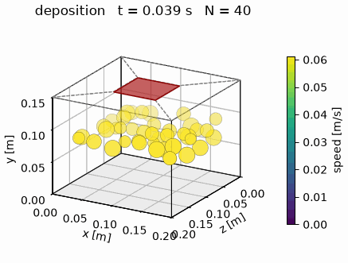
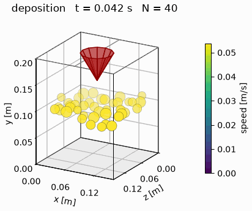
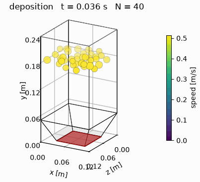
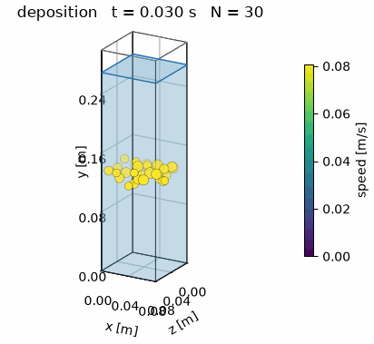
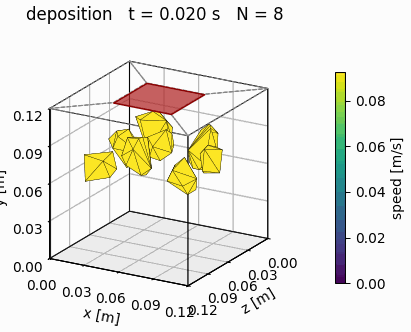

# DEMcookies

A small two- and three-dimensional Discrete Element Model (DEM) written in Python.

DEMcookies is a soft-particle code for granular materials. Spherical, polygonal (2D) or polyhedral (3D) particles are
rained into a polygonal (2D) or polyhedral (3D) container under gravity, the packing settles, and rigid bodies then load
it with a prescribed, time-dependent force. The particles may sit in pore water, which buoys them, drags on them and,
optionally, carries an excess pore pressure. The same code runs in two and in three dimensions; the geometry decides
which.


## Features

- Spherical, polydisperse particles with uniformly distributed random radii, moving in a plane (2D) or in space (3D).
- Convex polygonal (2D) and polyhedral (3D) particles, alone or mixed with spheres. Their contacts follow from the
  region where two bodies overlap, with the Hertz-Mindlin law and a contact radius measured on that region, and flat
  contacts also resist twisting.
- Gravity ("raining") deposition to build the initial packing.
- Hertz-Mindlin (no-slip) contact law with tangential history, viscous damping set by the coefficient of restitution,
  Coulomb friction and optional rolling resistance (in 3D, rolling is resisted and twisting is free).
- Velocity Verlet time integration with a time step set from the Rayleigh wave speed.
- Contact detection with a cell grid and a Verlet neighbour list.
- A polygonal domain (`Geometry`) whose edges, or a polyhedral domain (`Geometry3D`) whose planar faces, are each a
  `Wall`, `Open`, or a `LoadedPlaten`. Facets that share one `LoadedPlaten` form a single rigid body, such as a plate,
  a wedge, a curved indenter or a square footing. `Geometry3D.extrude` turns a 2D domain into a 3D prism.
- Load histories: `Pulse`, `Heaviside`, `Sinusoidal`, `TimeHistory`, or any function of time.
- Pore water below a water table, with buoyancy, porosity-dependent drag, optional seepage and an optional coupled
  excess pore pressure for undrained loading and consolidation.
- Animations of the simulation, in an oblique view or a vertical section in 3D, as GIF or as MP4 (with ffmpeg), and
  plots of the load-displacement response.
- Export to ParaView: the particles, the contact force chains and the moving boundary, as time series of VTK files.

## Installation

DEMcookies needs Python 3.12 or later. From the repository root:

```bash
python -m venv venv
source venv/bin/activate
pip install -e .
```

For development (tests, linting and type checking), install the pinned tools instead:

```bash
pip install -r requirements_dev.txt
pip install -e .
```

## Quick start

`main.py` runs the reference case: particles are rained into a 0.2 m x 0.6 m box, left to settle, and loaded through
the top edge with a load ramped to 1000 N in 0.4 s.

```bash
python main.py
```

The animation and the load-displacement curve are written to `output/`.

A simulation is built from a geometry, a material and a few settings:

```python
from DEMcookies import (DEMSimulation, Geometry, GlobalSettings, Heaviside, LoadedPlaten, MaterialProperties,
                        RainSettings, Wall)

load = Heaviside(amplitude=1000.0, rise_time=0.4)
geometry = Geometry.rectangle(width=0.2, height=0.6, bottom=Wall(), right=Wall(),
                              top=LoadedPlaten(load=load, mass=0.5), left=Wall())
material = MaterialProperties(density=2500.0, youngs_modulus=5.0e6, poisson_ratio=0.25,
                              restitution=0.4, friction=0.5)
sim = DEMSimulation(geometry, material, radius_range=(0.004, 0.02), settings=GlobalSettings(gravity=9.81))

sim.rain_until_full(RainSettings(batch_size=15, steps_between=450, record_every=60, seed=7))
sim.rest(0.1, record_every=60)      # let the packing settle [s]
sim.compress(1.0, record_every=60)  # apply the load through the platen [s]
```

See [main.py](main.py) for the full script, including the output.

### Three dimensions

The same simulation runs in 3D when the geometry is a polyhedron. The y axis stays vertical and z is the depth, so a
2D domain is a slice z = const of a 3D one. Initial particles, if any, are `Particle3D(x, y, z, radius)`, and the
rotations, angular velocities and torques become vectors.

```python
from DEMcookies import Geometry3D

geometry = Geometry3D.box(width=0.2, height=0.6, depth=0.2, bottom=Wall(), right=Wall(),
                          top=LoadedPlaten(load=load, mass=0.5), left=Wall(), back=Wall(), front=Wall())
sim = DEMSimulation(geometry, material, radius_range=(0.008, 0.02), settings=GlobalSettings(gravity=9.81))
```

Any closed polyhedron with planar faces can be built with `Geometry3D(vertices, faces, boundary_conditions)`, and
`Geometry3D.extrude(geometry_2d, depth)` extrudes a polygonal domain along z, with the boundary condition of each edge
on the face it sweeps. `render_animation` and `render_frame` draw a 3D simulation in an oblique view, or, given
`section=z`, as a vertical section that looks like the 2D pictures.

### Angular grains: polygons and polyhedra

Spheres roll past each other far too easily; rolling resistance mimics the interlocking of angular grains, and convex
polygons (2D) and polyhedra (3D) represent it directly. A shape is the convex hull of a set of points, and the radius
of a particle sets its size: a shaped particle of radius R has the area (2D) or the volume (3D) of the disc or sphere of
radius R, so it has the same mass, and a grading of spheres can be replaced by shapes as it stands.

```python
from DEMcookies import ConvexPolygon, ConvexPolyhedron, Particle3D

# rain a mix: each particle takes one of the shapes at random, in a random orientation; None is a sphere
shapes = [ConvexPolygon.regular(6), ConvexPolygon.random(7, seed=1, aspect=1.4), None]
sim = DEMSimulation(geometry, material, radius_range=(0.004, 0.02), shapes=shapes)

# or place them yourself: a 3D particle is oriented by a quaternion (w, x, y, z)
stone = ConvexPolyhedron.random(12, seed=3, aspect=(1.3, 1.0, 0.7))
particle = Particle3D(0.1, 0.05, 0.1, radius=0.015, shape=stone, orientation=(1.0, 0.0, 0.0, 0.0))
```

`ConvexPolygon.rectangle`, `ConvexPolygon.regular`, `ConvexPolyhedron.box`, `ConvexPolyhedron.tetrahedron` and
`ConvexPolyhedron.octahedron` make simple shapes, and `random` the hull of random points on an ellipse or ellipsoid,
e.g. for sand grains or ballast stones. `generate_lattice_particles` takes the same `shapes` list.

Two convex bodies overlap in one convex region, from whose volume (area in 2D), centroid and contact surface the contact
follows: the normal is the direction of the surface, the force acts at the centroid, and the Hertz-Mindlin law of the
spheres applies with a contact radius measured on the overlap. For two spheres this gives the Hertz force, and it stays
close to the exact force of a corner or a flat face. Polytopes get no rolling resistance; contacts between faces resist
twisting instead. Polyhedra rotate as rigid bodies with their full inertia tensor. A sphere touching a polytope presses
on its closest point, and a polytope pressing on a wall overlaps the solid behind the wall. Contacts of polytopes cost
several times more than those of spheres; the sections "Polygonal and polyhedral particles" of the manual give the
formulation and the numerics.

### GPU

Measuring how polygons and polyhedra overlap is most of the work of a simulation with shaped particles, and a GPU does
it many times faster. With `device="gpu"` a simulation keeps the shapes on the GPU and measures the overlaps there with
[CuPy](https://cupy.dev), while everything else, spheres included, stays on the CPU. The forces agree with those of the
CPU to rounding, and a run on either device repeats itself exactly; over many steps the two devices drift apart, as any
change of rounding makes a granular flow do. CuPy is optional: install it with `pip install -e ".[gpu]"` (for CUDA 12),
or a CuPy build that suits your CUDA. The default, `device="cpu"`, needs NumPy only.

```python
sim = DEMSimulation(geometry, material, radius_range=(0.004, 0.02), shapes=shapes, device="gpu")
sim.device = "cpu"  # e.g. to carry on with a checkpoint on a machine without a GPU
```

A pickled simulation holds nothing in the memory of the GPU, so a checkpoint made on a GPU carries on on a CPU and the
other way round. The ballast scripts take `--device gpu`.

### ParaView

A `VTKWriter` exports a simulation, 2D or 3D, to VTK files for [ParaView](https://www.paraview.org). Attached to a
simulation, it exports its state every `save_every_n_steps` time steps, whatever the stage and independently of the
frames recorded for the animations:

```python
from DEMcookies.vtk_export import VTKWriter

sim.add_observer(VTKWriter("output/vtk", save_every_n_steps=500))
sim.rain_until_full(RainSettings(record_every=60))
```

Every export adds a file to five time series, each listed with its simulation times in a `.pvd` collection:

| Collection | Content |
| --- | --- |
| `particles.pvd` | particle centres with their radius, velocity, angular velocity, number of contacts and mean stress (from the contact forces, positive in compression); with water, also the porosity, the force of the water and the excess pore pressure |
| `contacts.pvd` | a line per contact, between the centres of two particles or from a centre to a facet, with its normal force, tangential force and overlap |
| `boundary.pvd` | the facets of the domain at their current position, with their boundary condition and the force and pressure of the particles on them |
| `water.pvd` | the free surface of the water |
| `shapes.pvd` | the outline of every polygon, or the faces of every polyhedron, with the velocity, number of contacts and mean stress of its particle; empty for spheres |

The writer also leaves `paraview_setup.py` in the folder. Run it from the ParaView Python shell (View > Python Shell >
Run Script), or start ParaView with `paraview --script=output/vtk/paraview_setup.py`. It shows two views with linked
cameras at the end of the run: the particles as spheres of their true size, or as their polygons and polyhedra, coloured
by their speed, and the force chains, the contacts drawn as tubes that grow thicker with the normal force, with the
facets coloured by the pressure on them.

Exporting never changes the run. A writer pickled with its simulation, e.g. in a checkpoint, carries on with its
series when the simulation is resumed. `VTKWriter("output/vtk").write(sim)` exports the current state of any
simulation, e.g. one loaded from a checkpoint, and `sim.contacts()` returns the contacts of the current state for your
own analysis. An export of a few thousand 3D particles takes a few megabytes, so choose the interval with the length
of the run in mind. The ballast examples write ParaView files every 2000 steps, which `--save-every-n-steps` changes.

## Examples

The [examples/](examples/) folder holds more involved cases. Each writes its figures to `output/`.

### Two dimensions

| Script | Problem |
| --- | --- |
| [footing_on_trapezoid.py](examples/footing_on_trapezoid.py) | Strip footing on a fill in a trapezoidal container; the load history is chosen on the command line, e.g. `python examples/footing_on_trapezoid.py sinusoidal`. |
| [curved_indenter.py](examples/curved_indenter.py) | Rigid indenter with a curved base, made of several edges, pressed into a fill in a stepped container (`--peak` sets the peak load [N]). |
| [upward_seepage.py](examples/upward_seepage.py) | Upward seepage through a submerged column, from the quick condition to fluidization. |
| [consolidation.py](examples/consolidation.py) | Consolidation of a submerged column under a sudden load, compared with Terzaghi's theory. |
| [ballast_cyclic.py](examples/ballast_cyclic.py) | Cyclic loading of railway ballast under a sleeper: dry, half submerged and saturated. Runs fifteen parallel processes, about twenty minutes on sixteen cores. |
| [angular_grains.py](examples/angular_grains.py) | The same strip footing on free discs, on discs with rolling resistance and on angular polygons, and their load-settlement curves (`--peak` sets the peak load [N]). |

### Three dimensions

Each of these runs in a few minutes, apart from the polyhedra of `angular_grains_3d.py`, which take about twelve.

| Script | Problem |
| --- | --- |
| [square_footing_3d.py](examples/square_footing_3d.py) | Square footing in the middle of a granular bed in a box: the top of the box is split into the footing and four open faces (`--peak` sets the peak load [N]). |
| [cone_penetration_3d.py](examples/cone_penetration_3d.py) | A 60° cone of twelve faces pushed into a granular bed; the top of the box around it is made of two non-convex faces (`--peak` sets the peak load [N]). |
| [hopper_discharge_3d.py](examples/hopper_discharge_3d.py) | A bin with a hopper whose trap door opens: the grains drain out through the outlet at a constant rate. |
| [upward_seepage_3d.py](examples/upward_seepage_3d.py) | Upward seepage through a submerged column, from the quick condition to fluidization, the 3D counterpart of `upward_seepage.py`. |
| [angular_grains_3d.py](examples/angular_grains_3d.py) | Square footing on a bed of irregular polyhedral stones, with optional ParaView output that shows their faces (`--save-every-n-steps`). |

Their animations, kept in [examples/videos/](examples/videos/), show the particles coloured by speed:

| Square footing | Cone penetration |
| :---: | :---: |
|  |  |
| **Hopper discharge** | **Upward seepage** |
|  |  |
| **Angular stones** | |
|  | |

### Three-dimensional ballast study

[ballast_cyclic_3d.py](examples/ballast_cyclic_3d.py) is the 3D counterpart of `ballast_cyclic.py`: half a sleeper in a
box that holds one sleeper bay, on dry, half submerged and saturated ballast, with five packings of about 6600 grains.
A run of 50 load cycles takes some five hours on one core, so the study is split into jobs that a cluster runs in
parallel and that resume from their checkpoints: each packing is deposited once, then loaded in every case.

```bash
python examples/ballast_cyclic_3d.py deposit --packing 0
python examples/ballast_cyclic_3d.py load --packing 0 --case dry --cycles 50
python examples/ballast_cyclic_3d_post.py
```

[ballast_cyclic_3d.sbatch](examples/ballast_cyclic_3d.sbatch) submits the five depositions and the fifteen runs to a
SLURM cluster, and [ballast_cyclic_3d_post.py](examples/ballast_cyclic_3d_post.py) turns the results in
`output/ballast_3d/` into figures. Both stages also write ParaView files, every 2000 time steps by default
(`--save-every-n-steps`), some 1.2 GB per run.

To see what the shape of the stones does, `--grains polyhedra` runs the same study, and the preloaded one of
[ballast_cyclic_3d_preloaded.py](examples/ballast_cyclic_3d_preloaded.py), with irregular polyhedral stones of the same
grading and mass instead of spheres with rolling resistance, and
[ballast_cyclic_3d_shapes.py](examples/ballast_cyclic_3d_shapes.py) compares the two:

```bash
python examples/ballast_cyclic_3d.py deposit --packing 0 --grains polyhedra --device gpu
python examples/ballast_cyclic_3d.py load --packing 0 --case dry --grains polyhedra --device gpu
python examples/ballast_cyclic_3d_shapes.py              # or --preloaded
```

Polyhedra cost far more: a full packing takes some 31 h per load cycle on one core and 3 to 4.5 h on a laptop GPU, so
time the GPU you have with [benchmark_polyhedra.py](examples/benchmark_polyhedra.py) before planning a study; the
SLURM files explain how to submit the jobs to GPU nodes.

## Manual

The [manual/](manual/) folder holds a LaTeX manual that states the formulation, the numerical solution and the
verification and application examples. Build it with:

```bash
cd manual
pdflatex manual && bibtex manual && pdflatex manual && pdflatex manual
```

The figures in `manual/figures/` are produced by the scripts in [manual/scripts/](manual/scripts/), run from the
repository root, e.g. `python manual/scripts/reference.py`; `python manual/scripts/examples_3d.py` also renews the
animations in `examples/videos/`.

## License

DEMcookies is released under the MIT License; see [LICENSE](LICENSE).
