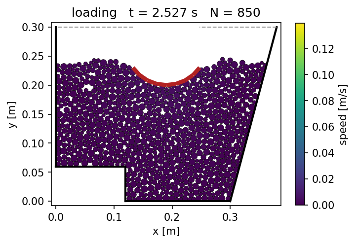

# DEMcookies

A small two-dimensional Discrete Element Model (DEM) written in Python.

DEMcookies is a soft-sphere code for granular materials. Circular particles are rained into a polygonal container
under gravity, the packing settles, and rigid bodies then load it with a prescribed, time-dependent force. The
particles may sit in pore water, which buoys them, drags on them and, optionally, carries an excess pore pressure.



## Features

- Circular, polydisperse particles with uniformly distributed random radii.
- Gravity ("raining") deposition to build the initial packing.
- Hertz-Mindlin (no-slip) contact law with tangential history, viscous damping set by the coefficient of restitution,
  Coulomb friction and optional rolling resistance.
- Velocity Verlet time integration with a time step set from the Rayleigh wave speed.
- Contact detection with a cell grid and a Verlet neighbour list.
- A polygonal domain whose edges are each a `Wall`, `Open`, or a `LoadedPlaten`. Edges that share one `LoadedPlaten`
  form a single rigid body, such as a plate, a wedge or a curved indenter.
- Load histories: `Pulse`, `Heaviside`, `Sinusoidal`, `TimeHistory`, or any function of time.
- Pore water below a water table, with buoyancy, porosity-dependent drag, optional seepage and an optional coupled
  excess pore pressure for undrained loading and consolidation.
- Animations of the simulation and plots of the load-displacement response.

## Installation

DEMcookies needs Python 3.12 or later. From the repository root:

```bash
python -m venv venv
source venv/bin/activate
pip install -e .
```

For development (tests, linting and type checking), install the pinned tools instead:

```bash
pip install -r requirements_dev.txt
pip install -e .
```

## Quick start

`main.py` runs the reference case: particles are rained into a 0.2 m x 0.6 m box, left to settle, and loaded through
the top edge with a load ramped to 1000 N in 0.4 s.

```bash
python main.py
```

The animation and the load-displacement curve are written to `output/`.

A simulation is built from a geometry, a material and a few settings:

```python
from DEMcookies import (DEMSimulation, Geometry, GlobalSettings, Heaviside, LoadedPlaten, MaterialProperties,
                        RainSettings, Wall)

load = Heaviside(amplitude=1000.0, rise_time=0.4)
geometry = Geometry.rectangle(width=0.2, height=0.6, bottom=Wall(), right=Wall(),
                              top=LoadedPlaten(load=load, mass=0.5), left=Wall())
material = MaterialProperties(density=2500.0, youngs_modulus=5.0e6, poisson_ratio=0.25,
                              restitution=0.4, friction=0.5)
sim = DEMSimulation(geometry, material, radius_range=(0.004, 0.02), settings=GlobalSettings(gravity=9.81))

sim.rain_until_full(RainSettings(batch_size=15, steps_between=450, record_every=60, seed=7))
sim.rest(0.1, record_every=60)      # let the packing settle [s]
sim.compress(1.0, record_every=60)  # apply the load through the platen [s]
```

See [main.py](main.py) for the full script, including the output.

## Examples

The [examples/](examples/) folder holds more involved cases. Each writes its figures to `output/`.

| Script | Problem |
| --- | --- |
| [footing_on_trapezoid.py](examples/footing_on_trapezoid.py) | Strip footing on a fill in a trapezoidal container; the load history is chosen on the command line, e.g. `python examples/footing_on_trapezoid.py sinusoidal`. |
| [curved_indenter.py](examples/curved_indenter.py) | Rigid indenter with a curved base, made of several edges, pressed into a fill in a stepped container (`--peak` sets the peak load [N]). |
| [upward_seepage.py](examples/upward_seepage.py) | Upward seepage through a submerged column, from the quick condition to fluidization. |
| [consolidation.py](examples/consolidation.py) | Consolidation of a submerged column under a sudden load, compared with Terzaghi's theory. |
| [ballast_cyclic.py](examples/ballast_cyclic.py) | Cyclic loading of railway ballast under a sleeper: dry, half submerged and saturated. Runs fifteen parallel processes, about twenty minutes on sixteen cores. |

## Manual

The [manual/](manual/) folder holds a LaTeX manual that states the formulation, the numerical solution and the
verification and application examples. Build it with:

```bash
cd manual
pdflatex manual && bibtex manual && pdflatex manual && pdflatex manual
```

The figures in `manual/figures/` are produced by the scripts in [manual/scripts/](manual/scripts/), run from the
repository root, e.g. `python manual/scripts/reference.py`.

## License

DEMcookies is released under the MIT License; see [LICENSE](LICENSE).
